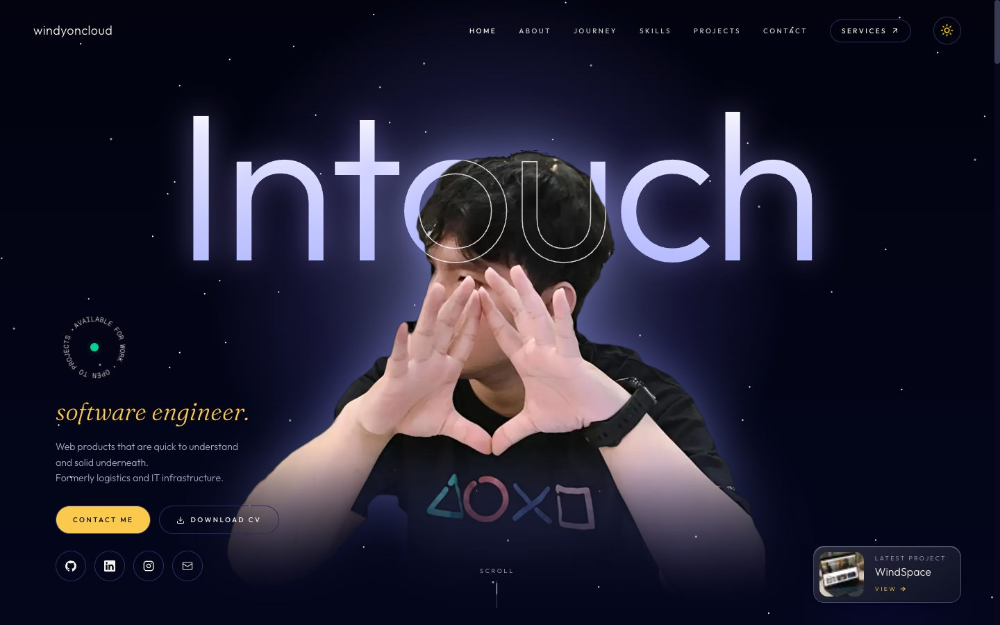
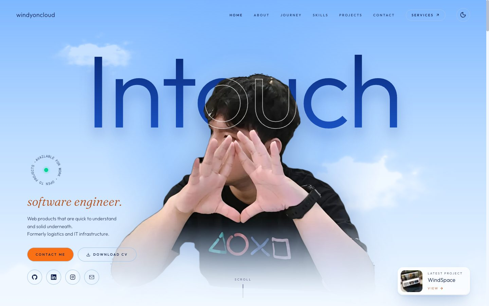
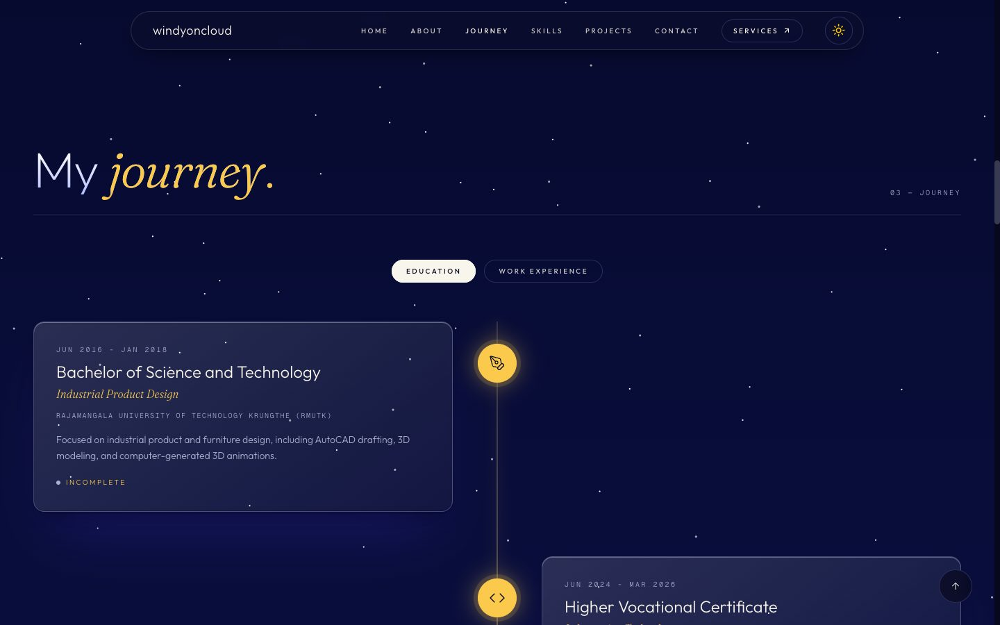
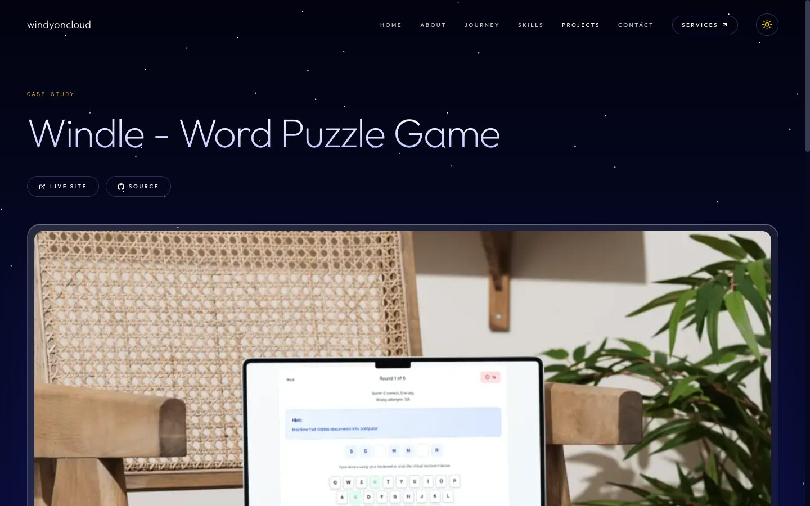
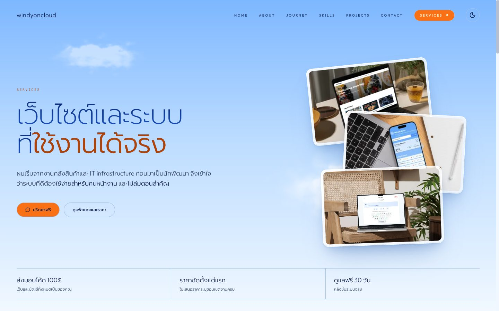

# windyoncloud

### My portfolio, set in a sky that changes as you scroll.

I'm Intouch, a software engineer who came to code from logistics and IT infrastructure. This is where my work, my path and my freelance services live. By day it's a blue sky with drifting clouds; switch to night and it's stars and the odd shooting star.

**[windyoncloud.me](https://windyoncloud.me)**



| Day | Journey | Case study |
| --- | --- | --- |
|  |  |  |

## Features

- An opening sequence on the first visit: a short terminal boot, then a water drop lands on my name and the page opens out from the splash. It plays once per session, and click, Space or Esc skips it.
- A cut-out portrait stands in front of a giant "Intouch", with an outline copy of the name drawn over the figure so the name still reads.
- Day and night themes. By day the sky goes from morning to afternoon to sunset as you scroll down the page. The theme toggle crossfades the whole page in one step.
- A timeline of my education and work, a skills grid with filters, and a stack of selected projects.
- A case study page for every project, each with its own share image.
- A Thai page at `/services` for freelance work, with packages, FAQ and an inquiry form.
- Works on phones, and respects reduced motion (no intro, no drifting).



## Stack

Next.js 16 (App Router), React 19, TypeScript, Tailwind CSS v4, GSAP for the intro, Lenis for smooth scrolling and next-themes. Forms go to Formspree. Hosted on Vercel.

## Running it

Needs Node 20.9+.

```bash
npm install
npm run dev
```

`npm run build && npm start` for a production build, `npm run lint` to lint.

The contact and inquiry forms need a Formspree endpoint. Copy `.env.example` to `.env.local` and fill it in:

| Variable | What it's for |
| --- | --- |
| `NEXT_PUBLIC_FORMSPREE_ENDPOINT` | Where both forms send. Without it the forms show an error. |
| `NEXT_PUBLIC_SITE_URL` | Optional. Used by metadata, the sitemap and share images. Defaults to `https://windyoncloud.me`. |

## Notes

All the motion runs in a single `requestAnimationFrame` loop (`ScrollReveal.tsx`). It measures layout only on resize, eases values towards their targets, and only moves things with transforms, so scrolling doesn't keep re-reading the page. Components opt in through data attributes such as `data-parallax`, `data-stack` or `data-tilt` rather than each running their own listener.

The sky is cheap on purpose. The clouds are four pre-rendered sprites reused at different sizes, blurs and speeds to give depth. Each star layer is one element with hundreds of `box-shadow`s, so a whole layer costs a single paint. Star positions come from a seeded random, so the server and the browser draw the same sky and there's no hydration flash.

Wheel scrolling is smoothed by Lenis; touch keeps the phone's own momentum. Anchor links and buttons go through the same Lenis instance, so they glide like the rest of the page.

The intro is skipped for return visits in the same session. A small script in the root layout marks the page before React loads, so a reload doesn't flash the terminal.

## Where things are

- `src/app/`: pages (`/`, `/projects`, `/projects/[slug]`, `/services`), the 404 page, share images, `sitemap.ts` and `robots.ts`
- `src/components/`: one file per section (`Hero`, `About`, `Journey`, `Skills`, `Projects`, `Contact`…) plus the intro (`IntroTerminal`, `IntroSplash`) and the sky (`SkyBackground`)
- `src/components/ScrollReveal.tsx`: the scroll and pointer motion described above
- `src/data/`: all the content: projects, journey, skills, certifications, services, testimonials and navigation
- `src/lib/site.ts`: the site URL
- `public/assets/`: photos, project screenshots, cloud sprites and the CV

Content changes don't need a component change. To add a project, add an entry to `projects` in `src/data/projects.ts`: its case study page, share image and sitemap entry are generated from it, and `featured: true` puts it on the home page. Sections such as testimonials and the landing page strip hide themselves when their list is empty. Entries in the `*Drafts` lists aren't shown anywhere until you move them into the live list.

## License

© 2026 Intouch Charoenphon. All rights reserved.
